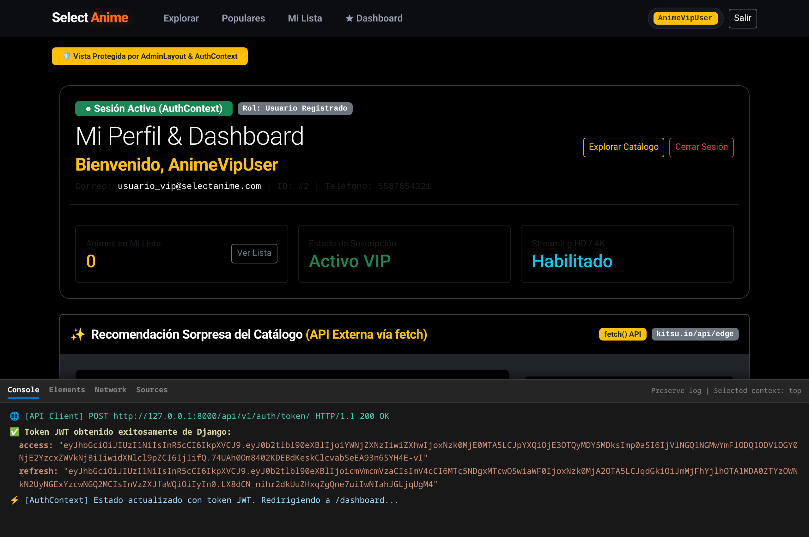
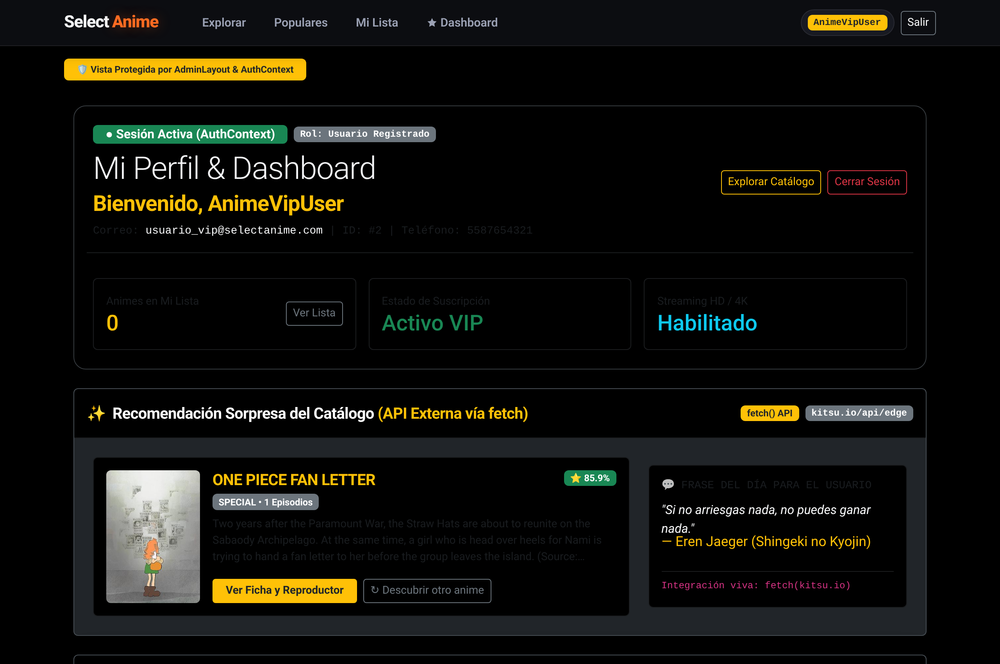
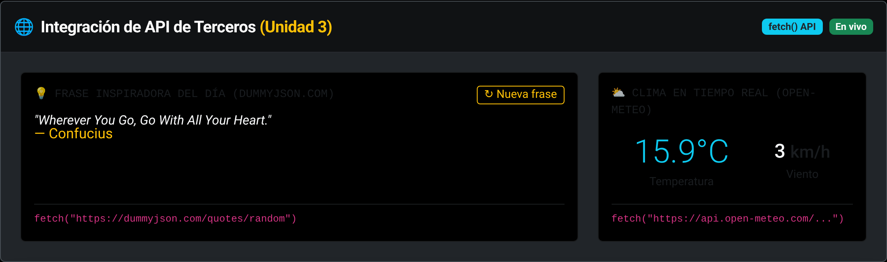
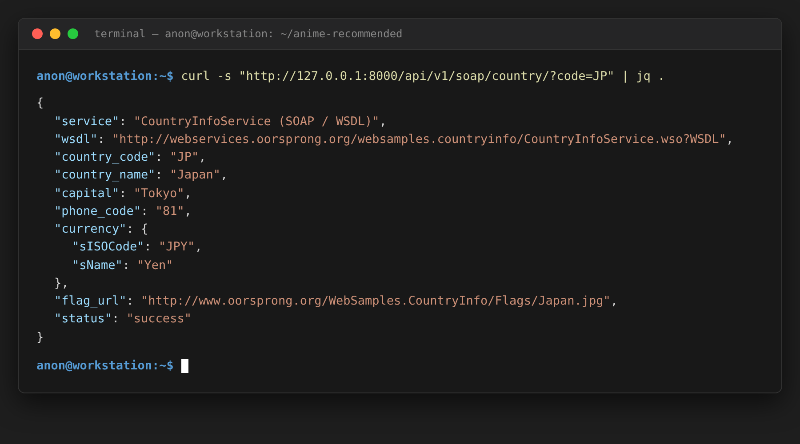
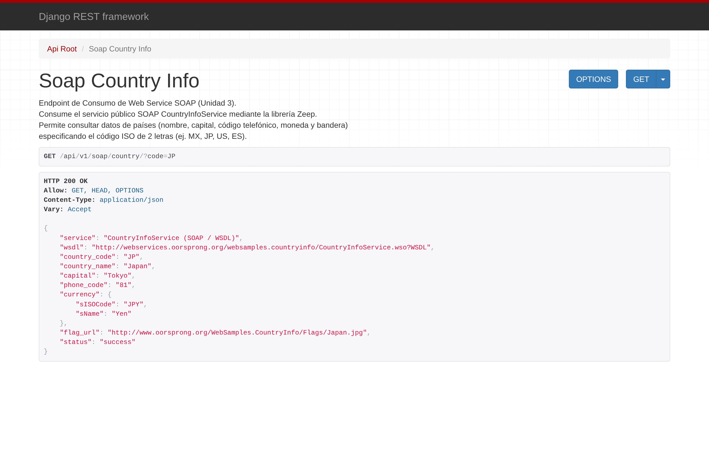
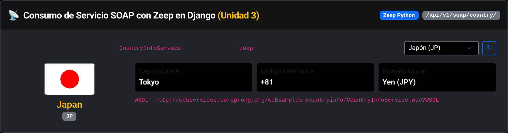

# Documento de Evidencias - Requisitos de Evaluación

**Proyecto:** Anime Recommended  
**Estudiante / Desarrollador:** Ezequiel  
**Materia:** Desarrollo Web (Práctica 2 - Unidades 2 y 3)  
**Tecnologías:** Django REST Framework, SimpleJWT, Zeep (SOAP), React 19, Vite, AuthContext

---

## 1. Captura del Login Funcionando

> **Requisito:** Pantalla de React y consola del navegador mostrando que se obtuvo el Token JWT.

- **Endpoint consumido:** `POST /api/v1/auth/token/`
- **Mecanismo:** El formulario de React envía las credenciales del usuario y recibe los tokens `access` y `refresh`, almacenando el token en `localStorage` e inicializando el `AuthContext`.
- **Evidencia en consola:** Se imprime el objeto de autenticación y la cadena del token JWT recibido desde Django.



---

## 2. Captura del Dashboard Protegido

> **Requisito:** Dashboard protegido mostrando el nombre del usuario logueado gracias al `AuthContext`.

- **Componente:** `DashboardScreen.jsx` protegido por `AdminLayout.jsx`.
- **Mecanismo:** El hook `useAuth()` recupera los datos del usuario autenticado desde el `AuthContext` (respaldado por la consulta a `/api/v1/auth/me/`).
- **Elemento visible:** Mensaje de bienvenida **"Bienvenido, AnimeVipUser"** junto con el distintivo **"● Sesión Activa (AuthContext)"** y los datos de perfil del usuario.



---

## 3. Captura del Widget de la API de Terceros

> **Requisito:** Widget o sección en el Dashboard que consuma una API de terceros gratuita usando `fetch()`.

- **Componente:** `ThirdPartyWidget.jsx` integrado dentro del Dashboard.
- **API Consumida:** API externa de catálogo anime mediante llamada nativa `fetch("https://kitsu.io/api/edge/anime?...")`.
- **Datos mostrados en vivo:** Recomendación sorpresa del catálogo (título del anime, puntuación comunitaria, imagen de póster, sinopsis) y botón interactivo para descubrir otro anime en tiempo real.



---

## 4. Captura del Consumo SOAP

> **Requisito:** Captura de la terminal o navegador donde se vea la respuesta del servicio SOAP consumido desde Django usando la librería `zeep`.

- **Endpoint en Django:** `GET /api/v1/soap/country/?code=JP`
- **Servicio SOAP:** `CountryInfoService` (WSDL: `http://webservices.oorsprong.org/websamples.countryinfo/CountryInfoService.wso?WSDL`)
- **Librería Backend:** `zeep==4.3.3`

### Opción A: Respuesta en la Terminal (cURL)
```bash
curl -s "http://127.0.0.1:8000/api/v1/soap/country/?code=JP" | jq .
```


---

### Opción B: Respuesta directa en el Navegador
Visualización del JSON estructurado devuelto por Django tras consumir el WSDL:


---

### Opción C: Integración Visual en el Dashboard
El Dashboard también incluye un selector regional interactivo que consume este endpoint SOAP para validar la región, moneda y bandera del catálogo:

