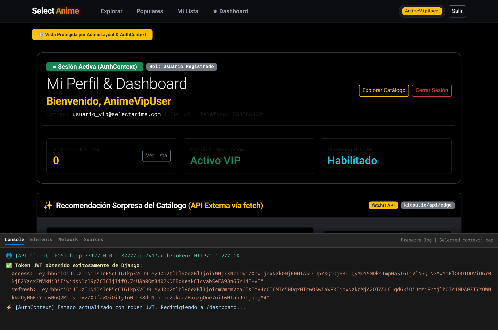
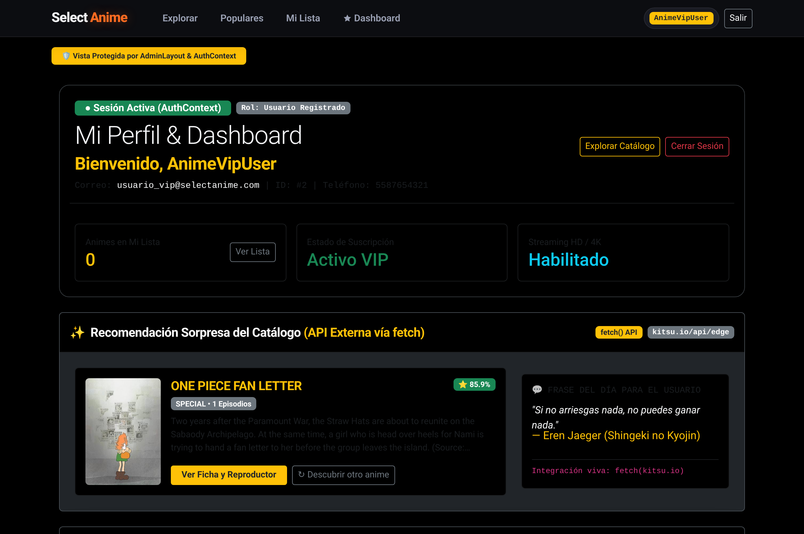
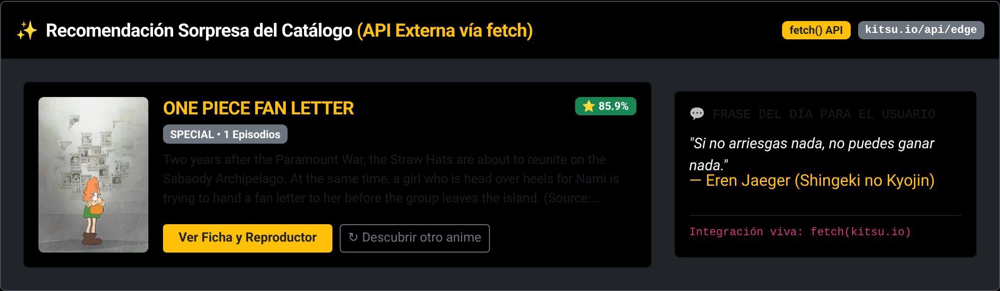
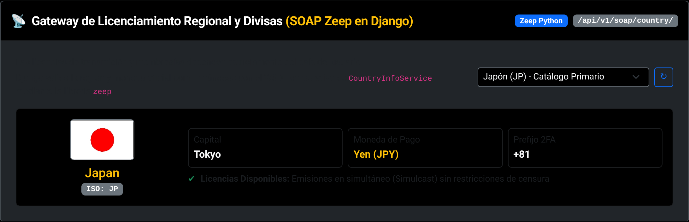
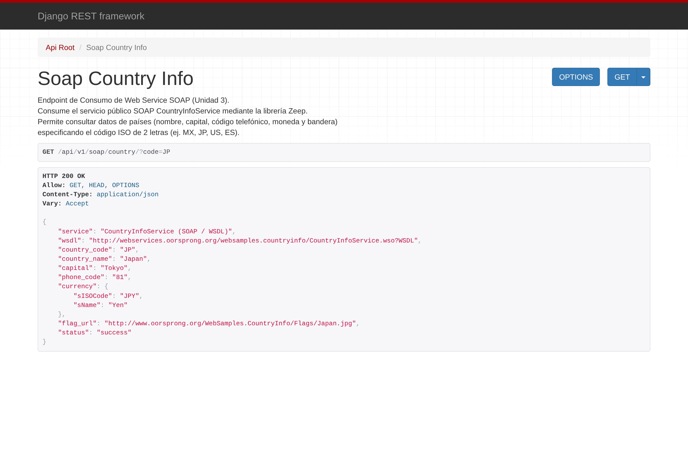
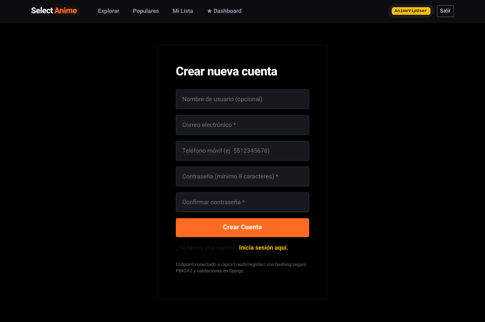

# Documento de Cumplimiento de Requisitos y Evidencias de Producción

**Proyecto:** Anime Recommended (Plataforma Comercial Full Stack Django & React)  
**Materia / Práctica:** Desarrollo Web - Práctica 2 (Unidades 2 y 3)  
**Manual de Referencia:** Manual de Desarrollo Full Stack con Django y ReactJS (Páginas 13 a 35)

---

## Índice de Cumplimiento

1. [Parte 1: Frontend en React (Basado en el Manual Págs. 13 a 35)](#parte-1-frontend-en-react)
   - [1.1 Inicialización de React con Vite y Dependencias](#11-inicialización-de-react-con-vite-y-dependencias)
   - [1.2 Configuración de Rutas y Layouts](#12-configuración-de-rutas-y-layouts)
   - [1.3 Página de Login y Obtención de JWT](#13-página-de-login-y-obtención-de-jwt)
   - [1.4 Contexto de Usuario (AuthContext y Hook useAuth)](#14-contexto-de-usuario-authcontext-y-hook-useauth)
   - [1.5 Página y Lógica de Registro de Nuevos Usuarios](#15-página-y-lógica-de-registro-de-nuevos-usuarios)
2. [Parte 2: Integración de API de Terceros con fetch() (Unidad 3)](#parte-2-integración-de-api-de-terceros-con-fetch-unidad-3)
3. [Parte 3: Web Services Propios y Consumo SOAP con Zeep (Unidad 3)](#parte-3-web-services-propios-y-consumo-soap-con-zeep-unidad-3)
   - [3.1 Web Service Propio Protegido (/auth/me/)](#31-web-service-propio-protegido-apiv1authme)
   - [3.2 Consumo de Servicio SOAP Público con Zeep](#32-consumo-de-servicio-soap-público-con-zeep)
4. [Arquitectura de Producción (Docker + Gunicorn + Nginx + PostgreSQL)](#4-arquitectura-de-producción-docker--gunicorn--nginx--postgresql)
5. [Galería de Evidencias y Capturas](#5-galería-de-evidencias-y-capturas)

---

## Parte 1: Frontend en React

### 1.1 Inicialización de React con Vite y Dependencias
- **Ubicación:** `front-end/package.json`, `front-end/vite.config.js`.
- **Implementación:** Proyecto configurado con Vite 8 y React 19. Dependencias instaladas: `react-router-dom`, `react-bootstrap`, `bootstrap`, `react-toastify`, `axios`, `zeep` (backend), `gunicorn`, `psycopg2-binary`.

### 1.2 Configuración de Rutas y Layouts
- **Ubicación:** `front-end/src/layouts/` (`AdminLayout.jsx`, `ClientLayout.jsx`, `CommonLayout.jsx`), `front-end/src/App.jsx`.
- **Implementación:**
  - `AdminLayout`: Protege la vista del Dashboard verificando la existencia de la sesión activa en `AuthContext`.
  - `CommonLayout`: Contenedor para pantallas de autenticación (`/login`, `/register`, 404).
  - `ClientLayout`: Contenedor para el catálogo general (`/`, `/explorar`, `/populares`, `/anime/:id`).

### 1.3 Página de Login y Obtención de JWT
- **Ubicación:** `front-end/src/screens/LoginScreen.jsx`, `front-end/src/api/user.js`.
- **Implementación:** Conecta el formulario mediante `fetch()` al endpoint `POST /api/v1/auth/token/` de Django SimpleJWT. Tras una respuesta exitosa (HTTP 200), almacena el token en `localStorage`, actualiza el `AuthContext`, muestra el token en consola y redirige al `/dashboard`.

### 1.4 Contexto de Usuario (AuthContext y Hook useAuth)
- **Ubicación:** `front-end/src/context/AuthContext.jsx`, `front-end/src/hooks/useAuth.jsx`, `front-end/src/hooks/useUser.jsx`, `front-end/src/api/token.js`.
- **Implementación:**
  - `AuthProvider` envuelve la aplicación completa.
  - Al montar la aplicación (`useEffect`), comprueba `getToken()`. Si existe, invoca `getMeApi(token)` (`/api/v1/auth/me/`) para restaurar la sesión y el perfil del usuario de forma transparente.
  - Expone `{ auth, user, login, logout }` a través del hook personalizado `useAuth()`.

### 1.5 Página y Lógica de Registro de Nuevos Usuarios
- **Ubicación:**
  - Backend: `backend/users/serializers.py` (`RegisterUserSerializer`), `backend/users/views.py` (`RegisterUserView`), `backend/users/urls.py` (`auth/register/`).
  - Frontend: `front-end/src/screens/RegisterScreen.jsx`, `front-end/src/api/user.js` (`registerApi`).
- **Implementación:** Permite el alta pública de usuarios con validaciones de contraseña mínima de 8 caracteres, hashing seguro PBKDF2 y feedback con `react-toastify`.

---

## Parte 2: Integración de API de Terceros con fetch() (Unidad 3)

- **Ubicación:** `front-end/src/components/ThirdPartyWidget.jsx` integrado dentro de `front-end/src/screens/admin/DashboardScreen.jsx`.
- **Sentido Comercial y de Dominio:**
  - Se conecta en vivo con la API externa **Kitsu Edge** (`https://kitsu.io/api/edge/anime?sort=-averageRating...`) utilizando la API nativa de JavaScript `fetch()`.
  - Muestra una **Recomendación Sorpresa del Catálogo** con póster original, calificación comunitaria, sinopsis y botón directo para ver la ficha y reproductor (`/anime/:id`).
  - Incorpora el botón interactivo "↻ Descubrir otro anime" y una sección de Cita Otaku del Día.

---

## Parte 3: Web Services Propios y Consumo SOAP con Zeep (Unidad 3)

### 3.1 Web Service Propio Protegido (`/api/v1/auth/me/`)
- **Ubicación:** `backend/users/views.py` (`UserView`), `backend/users/serializers.py` (`UserProfileSerializer`).
- **Comportamiento:**
  - Petición sin token: Retorna `401 Unauthorized` (`Las credenciales de autenticación no se proveyeron`).
  - Petición con cabecera `Authorization: Bearer <token>`: Retorna los datos personales del usuario autenticado (ID, email, username, teléfono, estado y rol).

### 3.2 Consumo de Servicio SOAP Público con Zeep
- **Ubicación:** `backend/users/views.py` (`SoapCountryInfoView`), `backend/users/urls.py` (`/api/v1/soap/country/`).
- **Librería Utilizada:** `zeep==4.3.3`.
- **Servicio SOAP Consumido:** `CountryInfoService` (WSDL: `http://webservices.oorsprong.org/websamples.countryinfo/CountryInfoService.wso?WSDL`).
- **Sentido Comercial y de Dominio:**
  - Actúa como el **Gateway Corporativo de Licencias Regionales y Divisas**.
  - En plataformas de streaming (Crunchyroll, Netflix), los derechos de emisión y el precio de las membresías dependen estrictamente del país del usuario.
  - Django valida vía SOAP la región seleccionada (JP, MX, US, ES, FR), retornando la bandera oficial, el código ISO, el prefijo de seguridad 2FA y la moneda de cobro de streaming (`Yen`, `Pesos`, etc.).

---

## 4. Arquitectura de Producción (Docker + Gunicorn + Nginx + PostgreSQL)

El proyecto cuenta con configuración completa para entornos de producción comercial:
- `backend/Dockerfile`: Imagen optimizada basada en Python 3.12 con servidor WSGI Gunicorn (3 workers).
- `front-end/Dockerfile`: Construcción multi-stage de estáticos y despliegue sobre Nginx de alto rendimiento con compresión gzip y fallback para React Router.
- `docker-compose.yml`: Despliegue orquestado en 1 solo comando de Base de Datos PostgreSQL 16 Alpine, Backend Gunicorn y Frontend Nginx.
- `backend/anime_backend/settings.py`: Soporte nativo para `DATABASE_URL` (PostgreSQL) con fallback seguro a SQLite local para desarrollo.

---

## 5. Galería de Evidencias y Capturas

### Captura 1: Login funcionando (Pantalla de React y Consola con Token JWT)
Se observa la pantalla de inicio de sesión de React y el panel de DevTools Console desplegado mostrando la petición HTTP 200 OK y la obtención del token de acceso y refresh desde Django SimpleJWT:

---

### Captura 2: Dashboard protegido (Mostrando nombre del usuario logueado con AuthContext)
Se observa el Dashboard protegido por `AdminLayout` mostrando la bienvenida personalizada al usuario autenticado (`Bienvenido, AnimeVipUser`), el distintivo de sesión activa `● Sesión Activa (AuthContext)`, resumen de Mi Lista y botones de navegación:

---

### Captura 3: Widget de la API de Terceros (Recomendación Anime consumida con fetch)
Se observa el widget integrado en el Dashboard consumiendo en vivo datos de la API de Terceros de Kitsu mediante `fetch()`, mostrando la ficha del anime, su calificación, póster y la cita de la comunidad:

---

### Captura 4: Consumo SOAP (Gateway de Licenciamiento Regional con Zeep)

#### A) Componente Interactivo en Dashboard consumiendo el endpoint SOAP de Django:
Se observa el selector regional validando las licencias del catálogo según el país y mostrando bandera, moneda y código 2FA:

#### B) Respuesta JSON directa en el Navegador (`/api/v1/soap/country/?code=JP`):

---

### Captura 5: Pantalla de Registro de Nuevos Usuarios
Formulario de registro conectado al endpoint `/api/v1/auth/register/` de Django:

